<p align="center">
  <picture>
    <source media="(prefers-color-scheme: dark)" srcset="docs/banner-dark.png">
    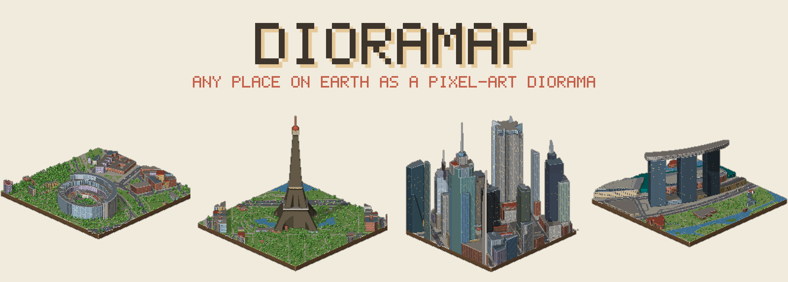
  </picture>
</p>

<p align="center">
  <a href="https://www.npmjs.com/package/dioramap"></a>
  <a href="https://github.com/omlahore/dioramap/stargazers"></a>
  
  <a href="LICENSE"></a>
</p>

<h3 align="center">Type a place. Get a tiny pixel-art city.</h3>

<p align="center">
  Your street, your hometown, the Eiffel Tower. Every building, road and river comes from real map data,<br>
  and it works for any place on Earth. Free, open source, no account and no API key.
</p>

<p align="center">
  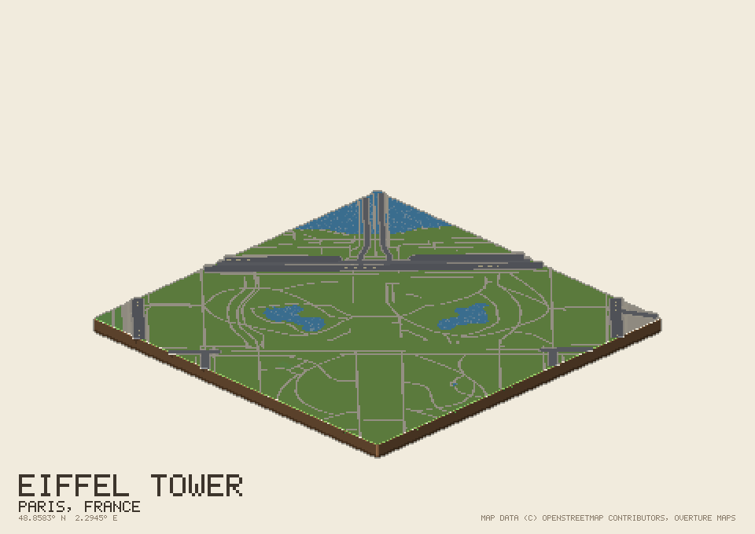
</p>

```bash
npx dioramap "Eiffel Tower, Paris"
```

<p align="center">
  <a href="#gallery">Gallery</a> &nbsp;·&nbsp;
  <a href="#make-your-own">Make your own</a> &nbsp;·&nbsp;
  <a href="#videos-and-gifs">Videos and GIFs</a> &nbsp;·&nbsp;
  <a href="#with-your-coding-agent">Coding agents</a> &nbsp;·&nbsp;
  <a href="#how-it-works">How it works</a>
</p>

## Gallery

Every one of these is a single command. Click any of them for the full-size poster.

<table>
  <tr>
    <td width="33%">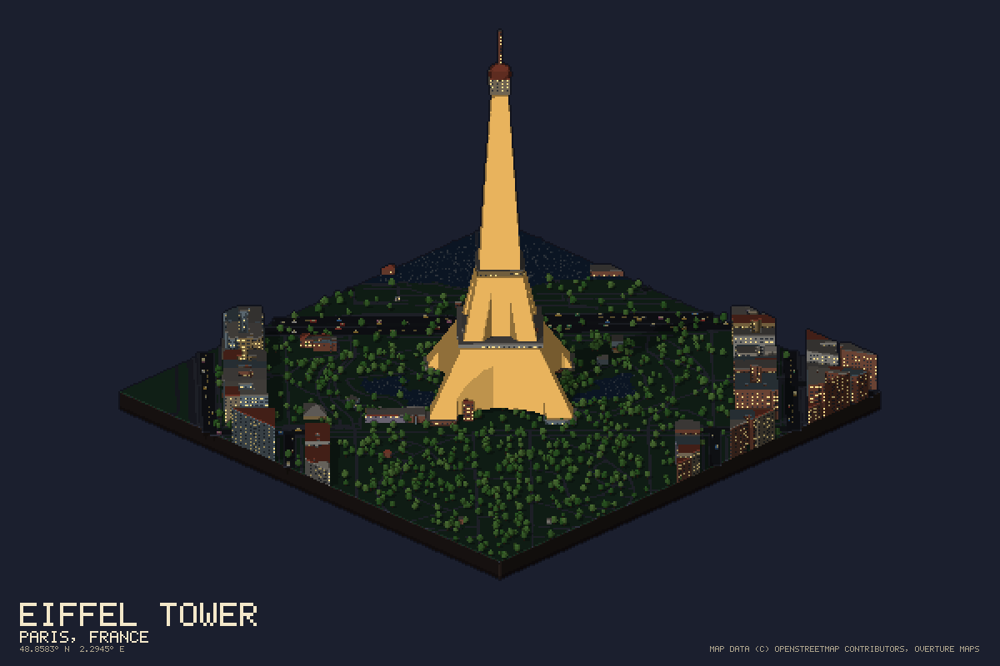<br><sub><code>"Eiffel Tower, Paris" -t night</code></sub></td>
    <td width="33%">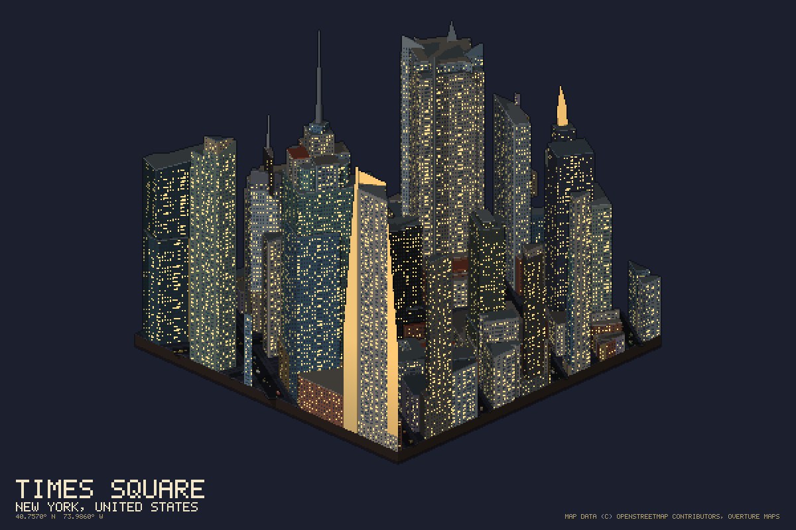<br><sub><code>"Times Square, Manhattan" -r 160 -t night</code></sub></td>
    <td width="33%">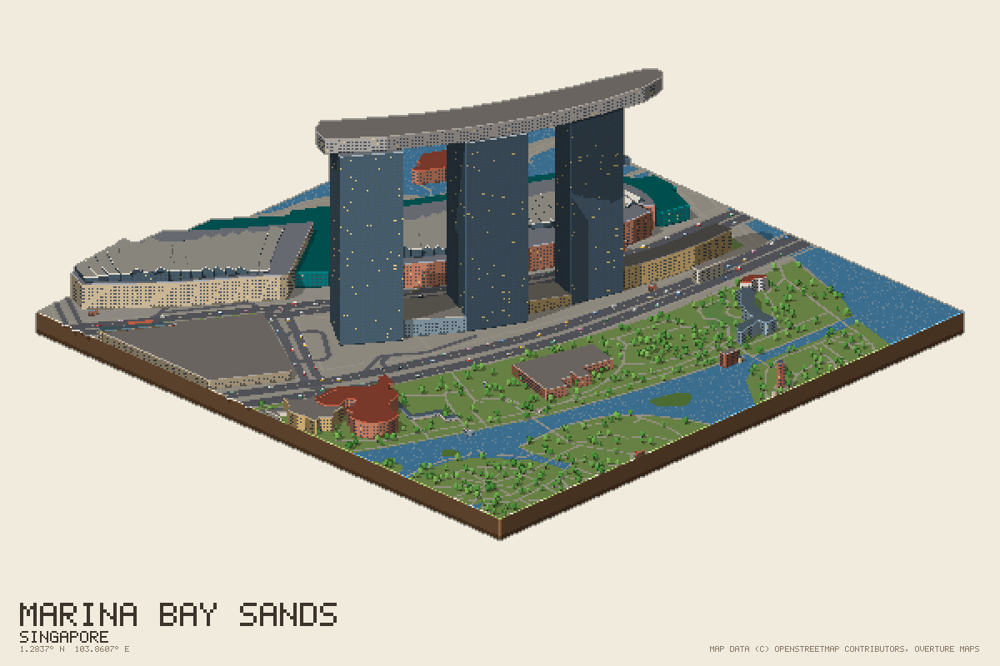<br><sub><code>"Marina Bay Sands, Singapore" -r 300</code></sub></td>
  </tr>
  <tr>
    <td>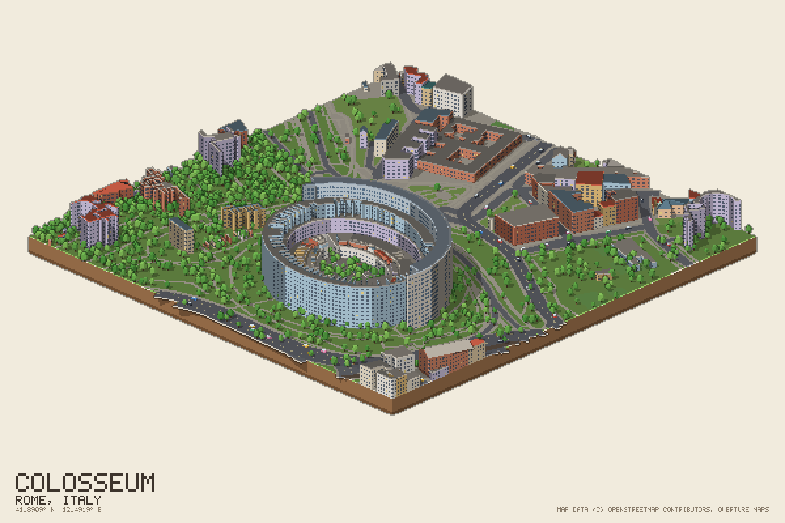<br><sub><code>"Colosseum, Rome" -r 200</code></sub></td>
    <td>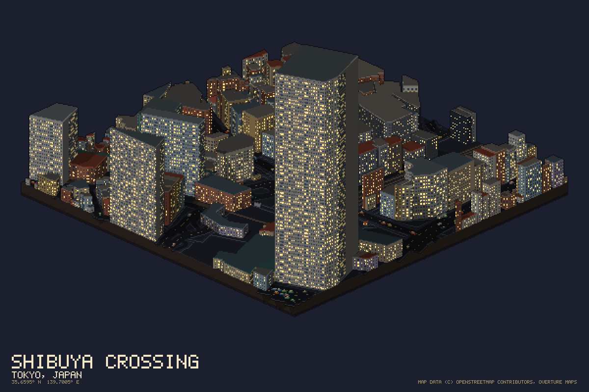<br><sub><code>"Shibuya Crossing, Tokyo" -t night</code></sub></td>
    <td>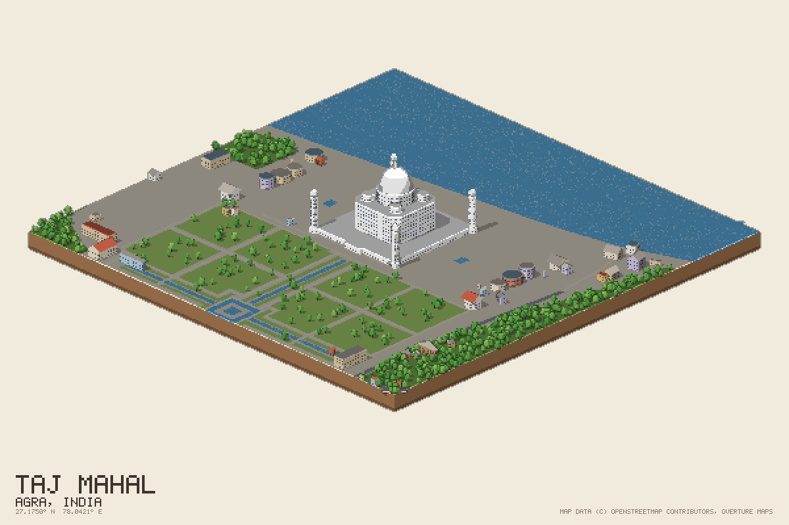<br><sub><code>"Taj Mahal, Agra"</code></sub></td>
  </tr>
  <tr>
    <td><br><sub><code>"Westerkerk, Amsterdam" --rotate 135</code></sub></td>
    <td>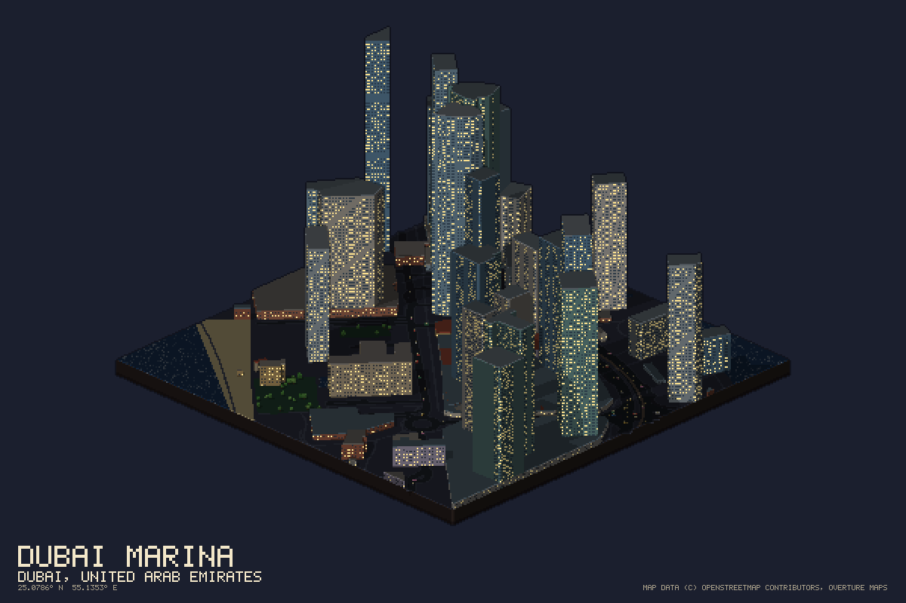<br><sub><code>"Dubai Marina" -r 260 -t night</code></sub></td>
    <td><br><sub><code>"Rialto Bridge, Venice" -r 160</code></sub></td>
  </tr>
  <tr>
    <td>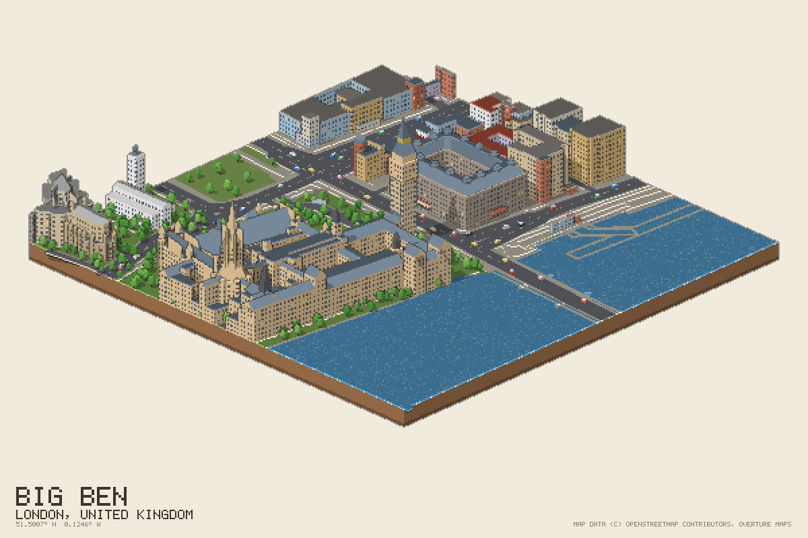<br><sub><code>"Big Ben, London"</code></sub></td>
    <td>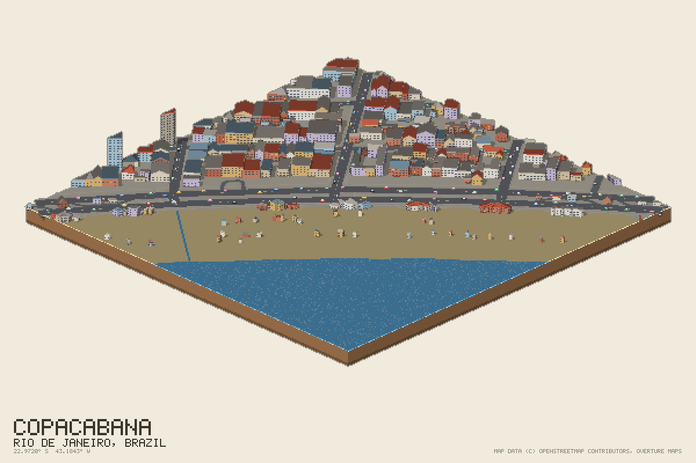<br><sub><code>"Copacabana, Rio de Janeiro"</code></sub></td>
    <td>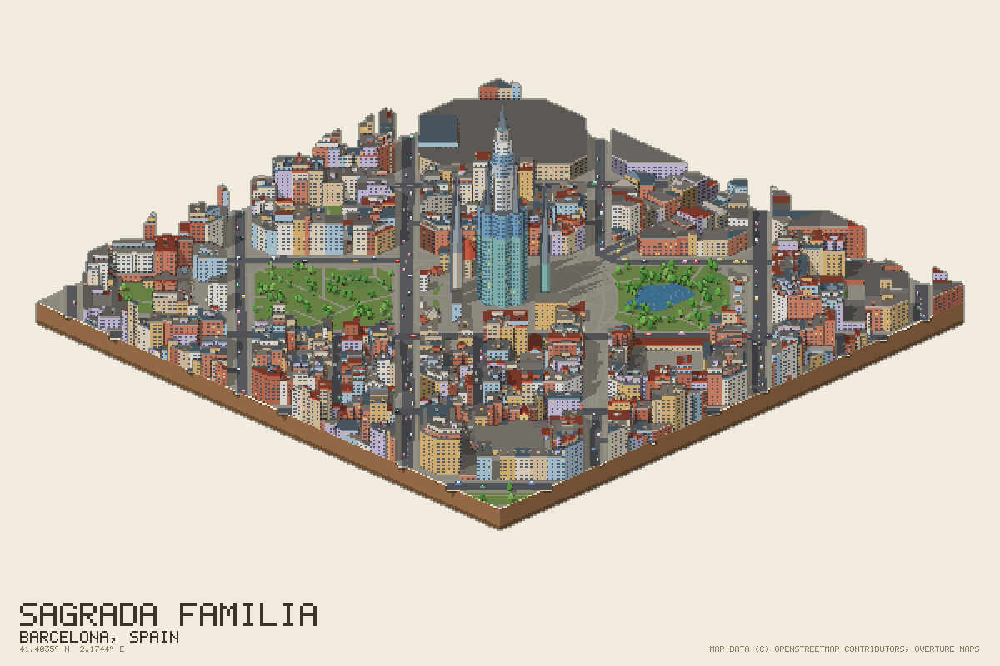<br><sub><code>"Sagrada Familia, Barcelona" -r 260</code></sub></td>
  </tr>
</table>

## Make your own

You need Node 20 or newer, plus Google Chrome, Microsoft Edge or Chromium. dioramap draws in a headless copy of the browser you already have.

```bash
npx dioramap "Shibuya Crossing, Tokyo"
npx dioramap "Times Square, Manhattan" -r 160 -t night
npx dioramap "48.8584, 2.2945" --title "Home"
```

A place name, a street address or a pair of coordinates all work. The poster lands in the current folder about ten seconds later.

Three settings change the picture the most:

- `-r` is half the width of the square, in metres. Use 120 to 180 for one landmark, 180 to 260 for a neighbourhood, and 250 to 400 for a downtown full of towers.
- `-t night` turns the windows on and floodlights landmarks like the Eiffel Tower. It looks best wherever there are towers.
- `--rotate 135` helps when a tall building hides the thing you care about. You can look from 45, 135, 225 or 315 degrees.

## Videos and GIFs

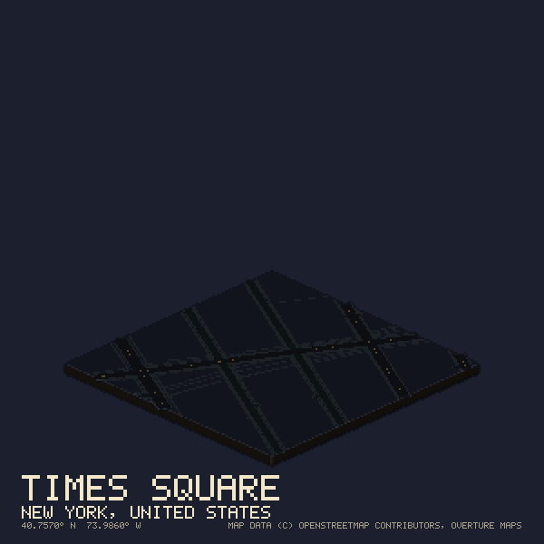

In the video the flat street map rises into the city, building by building, then night sweeps across the square and the lights come on. `--spin` turns the camera all the way round while that happens.

The browser encodes the video itself, so you don't need ffmpeg or anything else.

Videos come out at 1080x1350, the size X, Instagram and LinkedIn show biggest in the feed. Add `-s 1080x1920` for Reels, TikTok and Shorts.

<br clear="right">

```bash
npx dioramap "Dubai Marina" -t night --video
npx dioramap "Rialto Bridge, Venice" --gif
npx dioramap "Times Square, Manhattan" -t night --video --spin -s 1080x1920
```

## With your coding agent

```bash
npx skills add omlahore/dioramap
```

Then ask Claude Code, Codex or Cursor for something like "make a night diorama of the street I grew up on". The skill tells the agent how to pick the radius and the viewing side, and to check the picture before it shows it to you.

## Options

| Option | What it does |
|---|---|
| `-r, --radius <m>` | Half the width of the square, in metres, from 50 to 1000. Default 220. |
| `-t, --theme <day\|night>` | Night lights up the windows and floodlights landmarks. Default day. |
| `--rotate <45\|135\|225\|315>` | The side you look from. Default 45. |
| `--video` | Make an MP4 of the city rising and night falling. |
| `--gif` | The same thing as a looping GIF. |
| `--spin` | Turn the camera all the way round during the video. |
| `-s, --size <WxH>` | Exact output size in pixels. Default 1800x1200 for posters, 1080x1350 for video, 720x900 for GIFs. |
| `-p, --pixel <n>` | Screen pixels per art pixel. Bigger means chunkier. Default 3, or 4 for video. |
| `-o, --out <file>` | Where to save it. The extension picks the format: `.png`, `.mp4` or `.gif`. |
| `--title`, `--subtitle` | Change the text on the plaque. |
| `--no-plaque` | Just the map, no plaque. |
| `--save-data` | Also save the map data as JSON. |

## How it works

1. OpenStreetMap's Nominatim geocoder finds the place.
2. Roads, water, parks and land use come from [OpenFreeMap](https://openfreemap.org) vector tiles.
3. Buildings come from [Overture Maps](https://overturemaps.org), which merges OpenStreetMap with Microsoft and Google footprints, so towns that are thin on OpenStreetMap still get their buildings. dioramap reads both sources straight from static tiles. That's why there's no key and no rate limit to hit.
4. Buildings keep their mapped parts, heights and roof shapes: the Eiffel Tower's tapering legs, the dome of St Peter's, the setbacks of a Midtown tower. Where nobody mapped a height, it's guessed from the footprint and how built-up the area is.
5. [three.js](https://threejs.org) draws the scene at a third of the final size, with the 2:1 camera angle pixel artists use. It adds outlines, sun shadows, windows, trees and cars, then scales the image up with hard pixel edges. No AI touches the picture, so it's real pixel art and never blurry.

The result depends on the map data. Big cities look great. A place nobody has mapped in detail looks sparse, and dioramap won't invent buildings to fill it in.

## Credits

Map data © OpenStreetMap contributors ([ODbL](https://www.openstreetmap.org/copyright)) and the Overture Maps Foundation. Every poster carries that credit in its corner, so please keep it when you share one.

## License

MIT
