# dioramap

Any place on Earth as a pixel-art diorama.

<p align="center">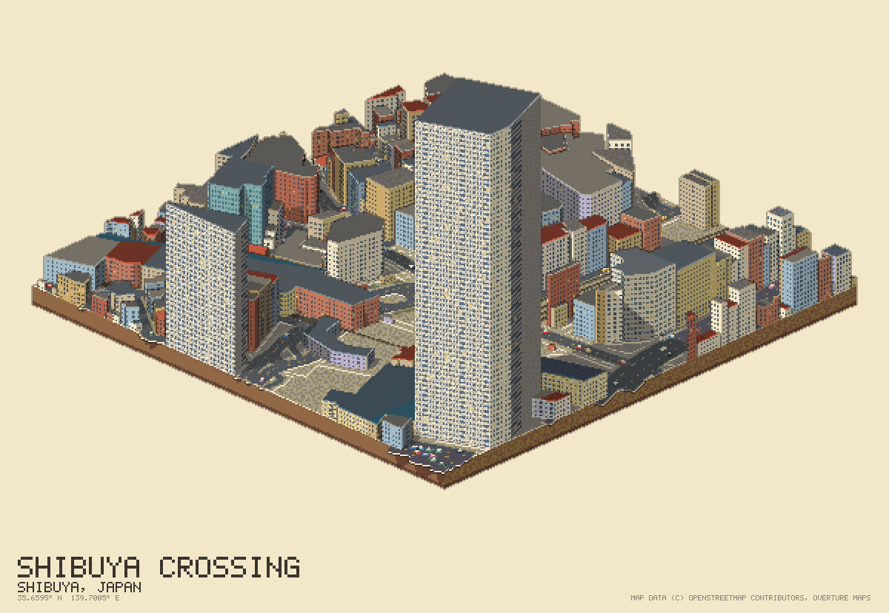</p>

```bash
npx dioramap "Shibuya Crossing, Tokyo"
```

Type a place, an address or a pair of coordinates and about a minute later you have a poster like the ones below. It's free and needs no API key or account. Every building, road, river and park comes from open map data, and the pixels are real pixel art: the 3D scene is drawn at a third of the size and scaled up with hard edges, so there's no AI painting and nothing blurry.

## Gallery

| | |
|---|---|
| 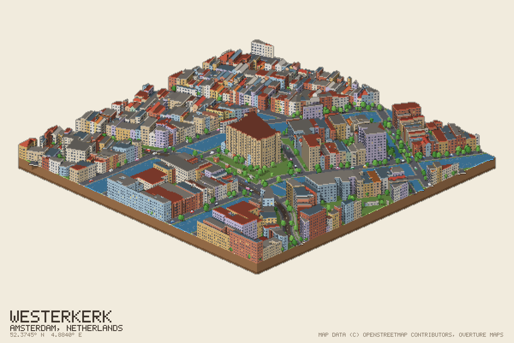 | 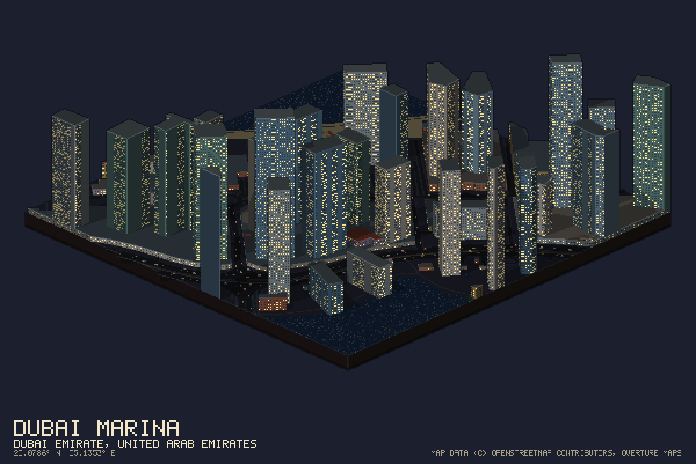 |
| 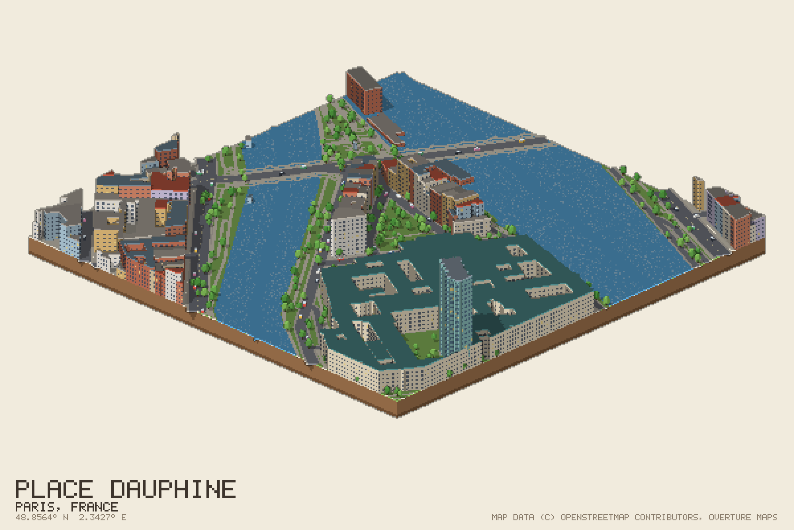 | 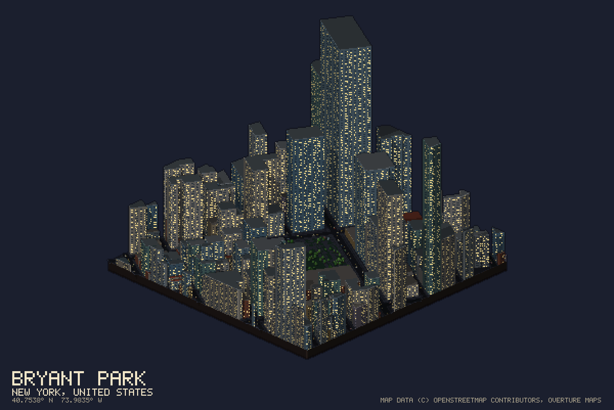 |
| 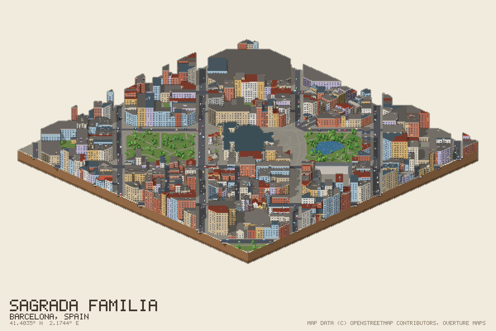 | 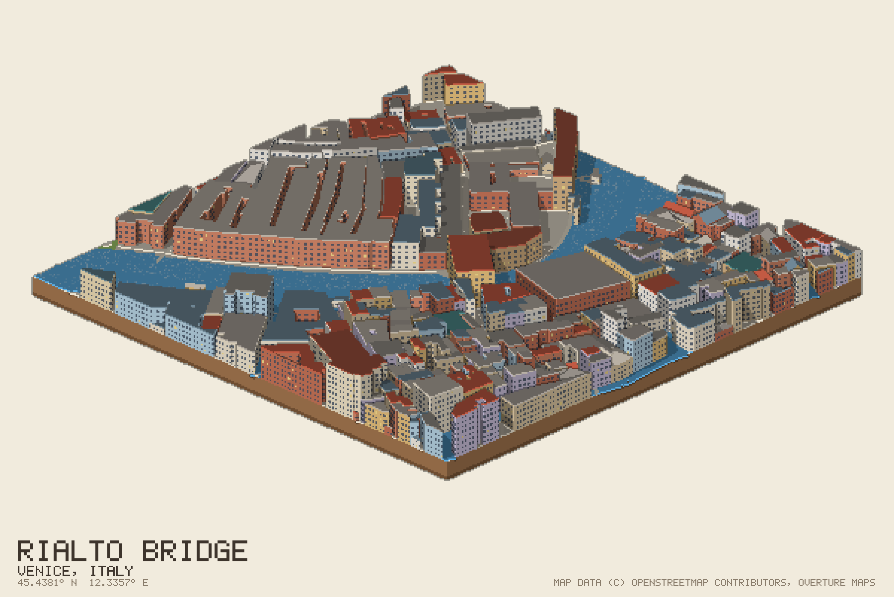 |
| 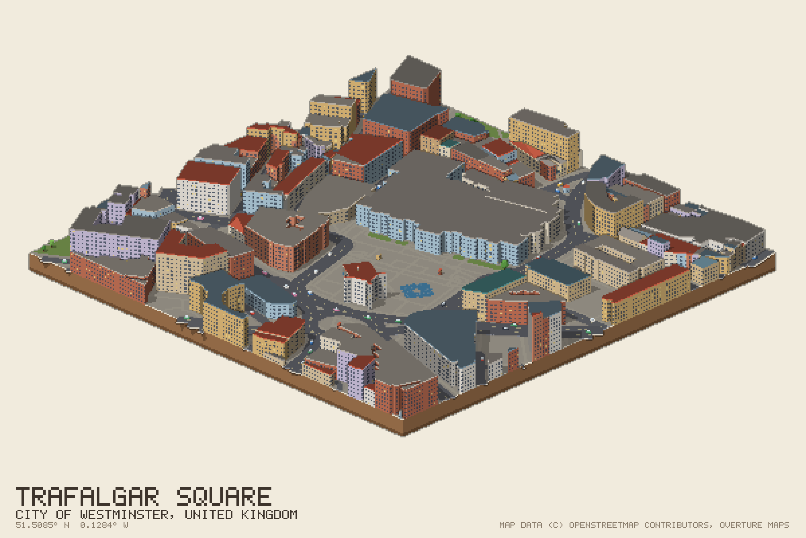 | 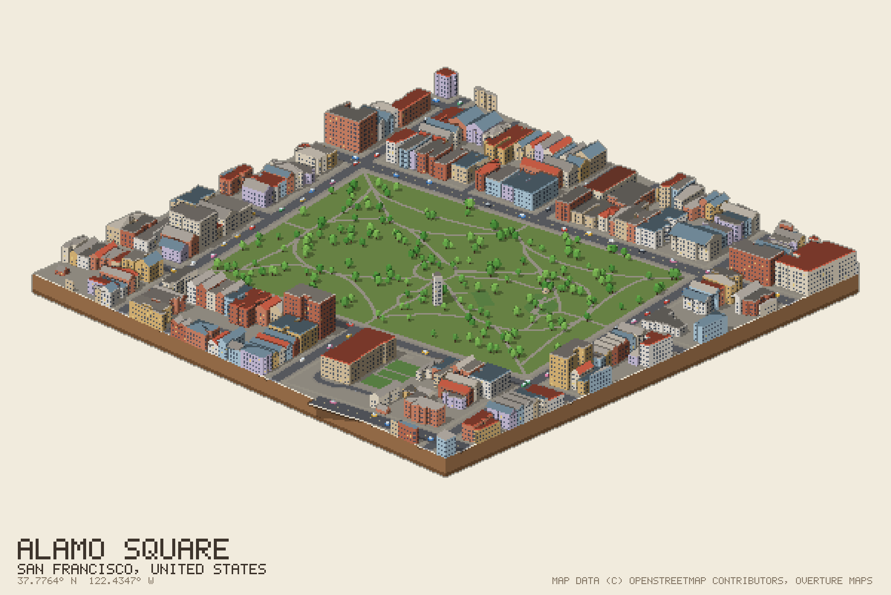 |
| 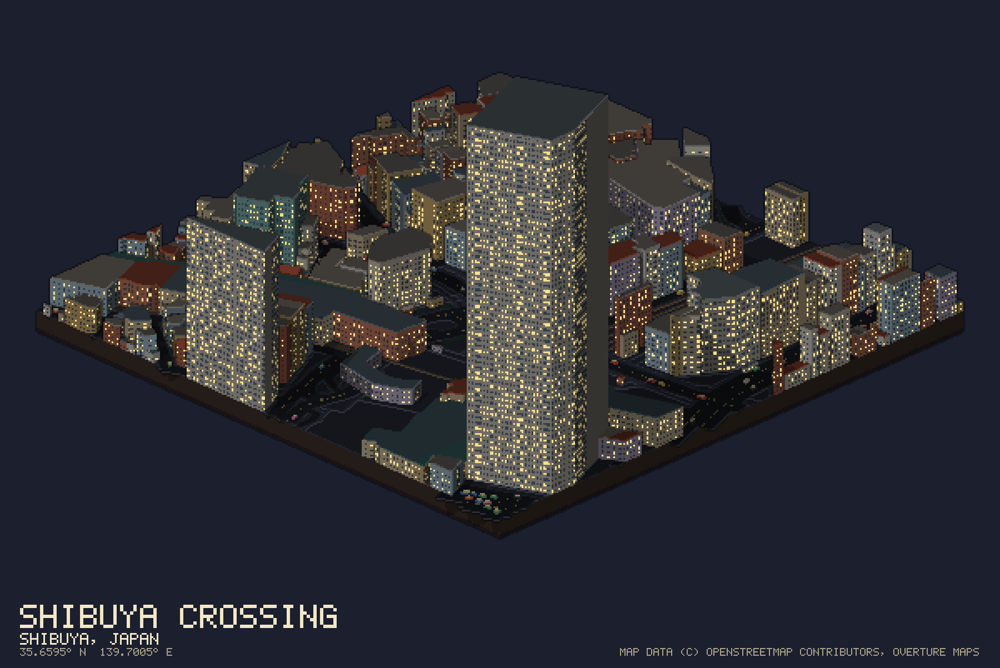 | 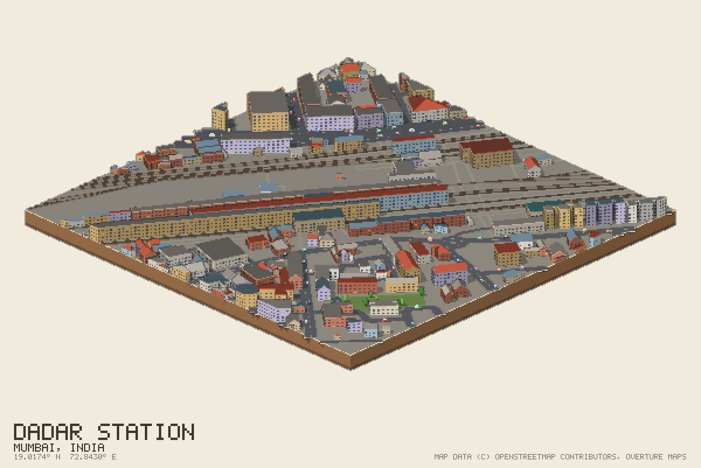 |

## Make your own

You need Node 20 or newer and Google Chrome, Microsoft Edge or Chromium installed (it renders in a headless browser).

```bash
npx dioramap "Alamo Square, San Francisco"
npx dioramap "Dubai Marina" -r 300 -t night
npx dioramap "48.8584, 2.2945" --title "Home" --subtitle "Paris"
```

| Option | What it does |
|---|---|
| `-r, --radius <m>` | Half-width of the square in metres. 120 to 180 for one square or landmark, 180 to 260 for a neighbourhood, 250 to 400 for a downtown. Default 220. |
| `-t, --theme <day\|night>` | Night lights up the windows. Default day. |
| `--rotate <45\|135\|225\|315>` | Which side you look from. Try another one if a tower hides what you care about. |
| `-s, --size <WxH>` | Output size in pixels. Default 1800x1100. |
| `-p, --pixel <n>` | Screen pixels per art pixel. Default 3. |
| `-o, --out <file>` | Where to save the PNG. |
| `--title`, `--subtitle` | Change the text on the plaque. |
| `--no-plaque` | Just the map. |

## With your coding agent

```bash
npx skills add omlahore/dioramap
```

Then ask Claude Code, Codex or Cursor something like "make a night diorama of the street I grew up on". The skill tells the agent how to pick the radius and the side to look from, and to check the result before showing it to you.

## How it works

1. The place name goes to OpenStreetMap's Nominatim geocoder.
2. Roads, water, parks and land use come from [OpenFreeMap](https://openfreemap.org) vector tiles.
3. Buildings come from [Overture Maps](https://overturemaps.org), which merges OpenStreetMap with Microsoft and Google building footprints, so towns that are thin on OpenStreetMap still get their buildings. Both are read straight from static tiles, which is why there's no key and no rate limit to hit.
4. [three.js](https://threejs.org) draws everything with an orthographic camera at the 2:1 angle pixel artists use, at a third of the final size. Then it adds outlines, sun shadows, windows, pitched roofs on small buildings, trees and cars, and scales it up with hard pixels.
5. Building heights come from the map where someone mapped them. Otherwise they're guessed from the footprint and how built-up the area is.

Famous landmarks with spires or domes come out as blocks for now, because only the building outline is used.

## Credits

Map data © OpenStreetMap contributors ([ODbL](https://www.openstreetmap.org/copyright)) and the Overture Maps Foundation. Every poster carries that credit in its corner, so please keep it when you share one.

## License

MIT
